# drone-autonomy

A quadrotor autonomy stack built from scratch in simulation: noisy sensors, a 15-state navigation filter, 3D path planning, minimum-snap trajectories, cascaded control, multi-vehicle coordination and air-ground cooperation. NumPy and Matplotlib only.

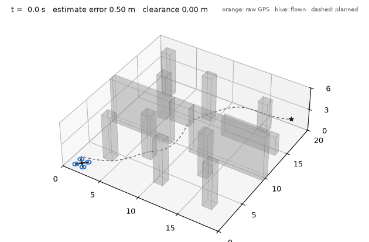

The vehicle waits on the ground while its filter converges, takes off, and flies through a doorway and over a low wall to the goal. The orange dots are raw GPS readings; the controller never sees the true state.

## Why this project

I started from a quadrotor that could fly a figure-eight because the controller was handed its exact position (`quadrotor-control`). This project removes that shortcut step by step and asks, at each layer, what breaks and what fixes it: what the sensors really provide, how to estimate the state, how to find a path, how to turn a path into something flyable, and how several vehicles share the same space.

## Architecture

```
sensors.py      accelerometer, gyroscope, GPS, compass with noise and bias
navigation.py   15-state error-state Kalman filter
world.py        obstacle world and occupancy grid
planner.py      A* search and path shortcutting
trajectory.py   minimum-snap polynomial trajectories
drone.py        rigid-body model and cascaded PID controller
swarm.py        multi-vehicle simulation and collision avoidance
ground.py       road, bridge and a car with pure-pursuit steering
```

The scripts `s1_...` to `s13_...` are the experiments, in the order the project was built.

## 1. Why sensors cannot be trusted directly

One vertical axis, a GPS with 0.7 m noise and an accelerometer with a 0.05 m/s2 bias.

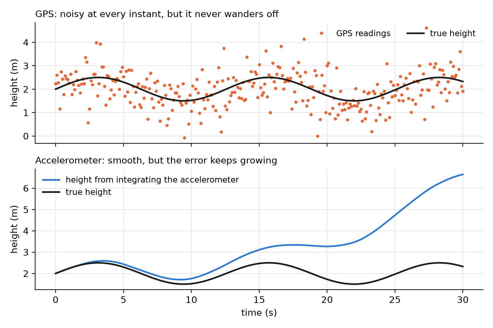

| Method | Height error |
|---|---|
| GPS alone | 0.66 m rms, does not grow |
| Accelerometer integrated twice | 22.3 m after 30 s, grows with time squared |
| Kalman filter, bias not modelled | 0.41 m rms with a constant offset of +0.39 m |
| Kalman filter with the bias as a state | 0.12 m rms, offset +0.02 m |

A bias `b` integrated twice gives a position error of `b * t^2 / 2`. The filter that ignores the bias is wrong and confident: its own uncertainty stays small while the error does not. Adding the bias to the state lets the filter find it (0.048 after 15 s, true value 0.050) although no sensor measures it.

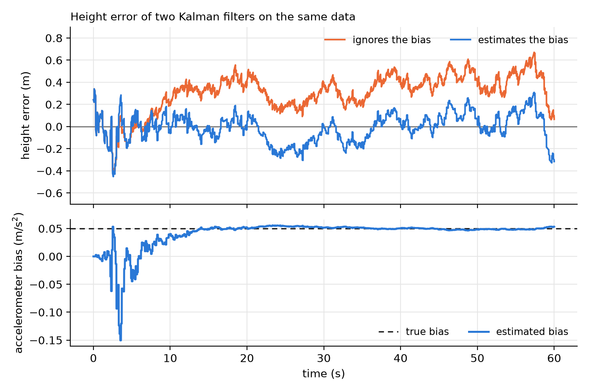

## 2. Flying on estimates

The same controller on the same figure-eight, fed three different ways.

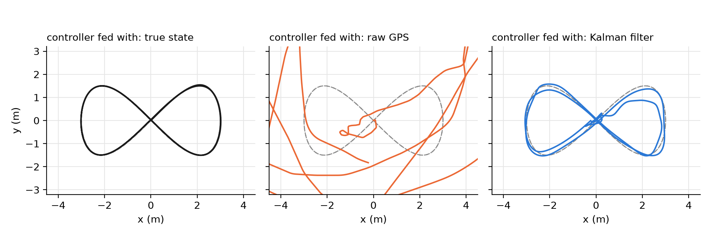

| Controller fed with | Tracking error rms | Tracking error max |
|---|---|---|
| True state | 0.038 m | 0.056 m |
| Raw GPS, velocity by differencing | 3.94 m | 6.70 m |
| Kalman filter | 0.34 m | 0.69 m |

Raw GPS is unusable mainly because of velocity: differencing 0.5 m of position noise over 0.1 s gives velocity noise of several metres per second.

The full navigation filter estimates position, velocity, attitude, accelerometer bias and gyroscope bias from an accelerometer and gyroscope at 500 Hz, GPS at 10 Hz and a compass at 50 Hz. With every quantity estimated, the tracking error is 0.35 m rms, the attitude error 0.40 degrees, and the gyroscope bias is recovered to within 2%.

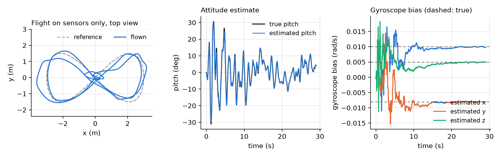

The horizontal accelerometer bias is not recovered well (true 0.05 and -0.04, estimated 0.08 and 0.03). A horizontal bias and a small tilt error both appear as a spurious horizontal acceleration, and this flight does not excite the vehicle enough to separate them.

## 3. Finding a path

A 20 x 20 x 6 m world with pillars, a full-height wall with one doorway and a low wall, on a 0.5 m grid.

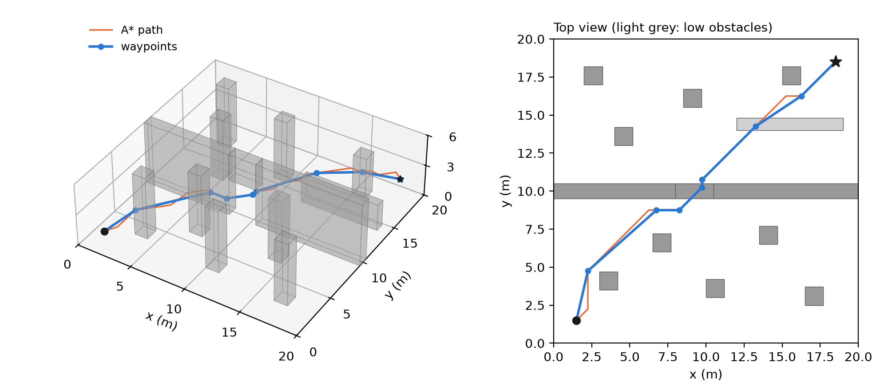

| Search | Path length | Cells examined |
|---|---|---|
| Dijkstra | 26.75 m | 13,776 |
| A* with straight-line heuristic | 26.75 m | 2,859 |

Both find the same shortest grid path; A* examines about a fifth of the cells. Shortcutting reduces 41 path points to 9 waypoints.

## 4. From waypoints to a trajectory

Seventh-order polynomial segments with continuous derivatives up to the sixth, zero velocity, acceleration and jerk at both ends.

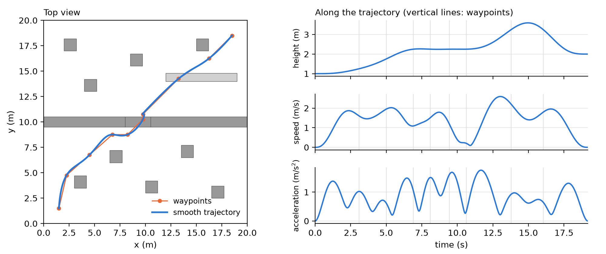

Smoothing moves the trajectory away from the planned polyline: the first solution passes 0.14 m from an obstacle. The trajectory is checked against the obstacles and a waypoint is inserted where it comes too close, which restores 0.61 m. The final trajectory needs at most 1.76 m/s2 of acceleration, about 10 degrees of tilt.

## 5. The whole chain

Plan, smooth, and fly on sensors only (the animation at the top).

| Quantity | Value |
|---|---|
| Raw GPS error | 0.97 m rms |
| Position estimate error | 0.23 m rms, 0.57 m max |
| Tracking error | 0.30 m rms, 0.61 m max |
| Closest approach of the plan to an obstacle | 0.92 m |
| Closest approach of the vehicle to an obstacle | 0.58 m (vehicle radius 0.3 m) |
| Distance from the goal at the end | 0.12 m |

The planning margin is 1.0 m, not the 0.5 m used in section 3. The vehicle strays up to 0.61 m from its plan, so a plan with 0.5 m of margin would have ended in a collision. The planner has to know how inaccurate the layers below it are.

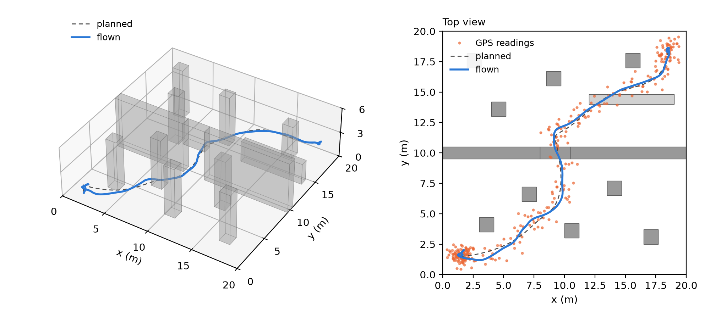

## 6. Several vehicles

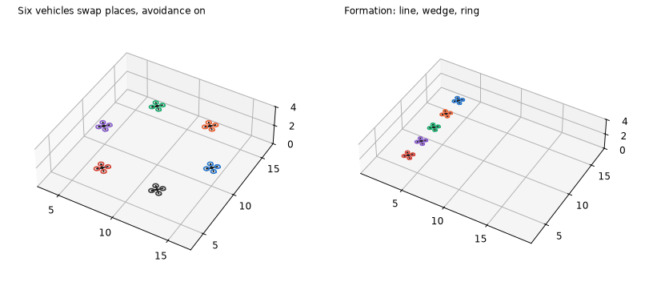

Six vehicles on a circle each fly to the opposite point. Avoidance is a repulsive velocity between neighbours within 2.2 m, with a sideways component so that vehicles meeting head-on turn the same way.

| Avoidance | Closest pair | Collision |
|---|---|---|
| Off | 0.06 m | yes |
| On | 0.88 m | no |

Five vehicles hold a moving formation that changes from a line to a wedge to a ring. The distance to the assigned slot is 0.31 m rms and 1.63 m at worst, during the shape changes; the closest pair stays 1.71 m apart. Formation spacing has to exceed the avoidance range, otherwise avoidance pushes vehicles out of their slots.

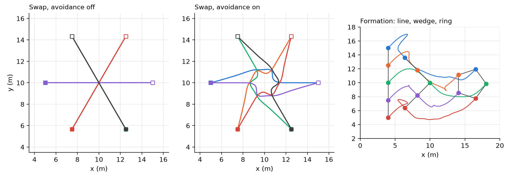

## 7. Following a car

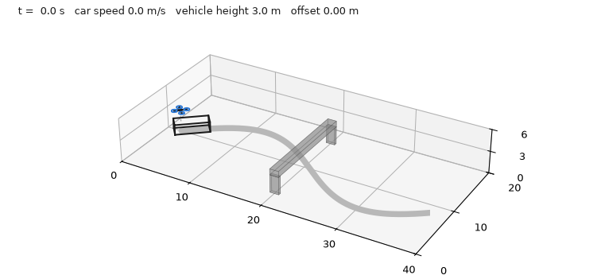

A car with pure-pursuit steering drives an S-shaped road at 3.0, 1.8 and 4.0 m/s and passes under a bridge. The quadrotor holds position 3 m above it, using the car's velocity as feed-forward, and climbs over the bridge deck.

| Quantity | Value |
|---|---|
| Horizontal offset from the car | 0.20 m rms, 0.38 m max |
| Height over the bridge deck | 1.60 m clearance |
| Largest tilt | 16.8 degrees |

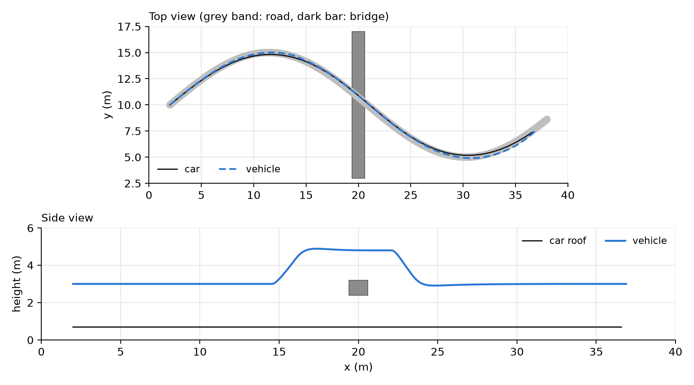

## Limits

- Simulation only, with an idealised vehicle: no motor dynamics, no rotor aerodynamics, no delays.
- Sensor